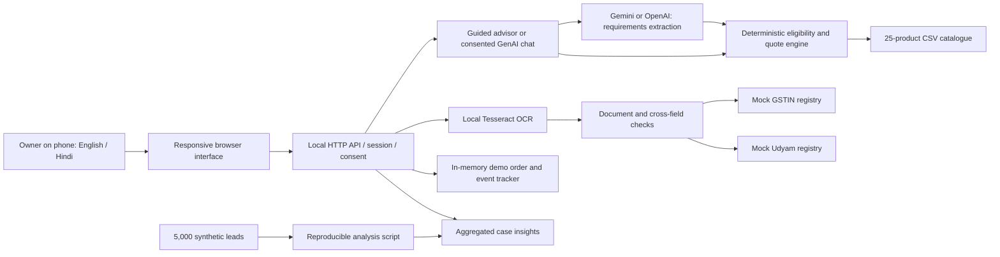

# Udyam Digital — architecture

## Current implementation

- Python standard-library HTTP server, bound to 127.0.0.1; vanilla JavaScript UI; no application framework or hosted database.
- All quote calculations and product eligibility checks run on the server. The browser cannot set authoritative prices or bypass KYC through a form field.
- Optional GenAI advisor extracts structured business requirements using the selected provider with a JSON schema and server validation. Missing fields trigger follow-up questions. Only validated requirements enter the deterministic catalogue/quote engine. Guided questions remain the fallback. A real model test is pending key configuration.
- OCR is actual Tesseract recognition, performed locally. Specimen OCR is reproducibly cached by image SHA-256 to make demonstrations fast and portable. This cache contains extracted text, not judges' labels or expected decisions.
- New image uploads are transient. Their extracted text is kept only in the isolated session; raw images are deleted immediately after extraction.
- HTTP-only, SameSite=Strict session cookie plus CSRF token; no browser localStorage, external fonts, analytics or CDN. Only consented AI messages invoke the selected provider API, from the backend.
- Registry checks are mocked against supplied CSVs; no government service, payment provider, e-sign or real installation integration is claimed.
- Installation progress advances only through a labelled simulation control. Estimated activation uses the catalogue's slowest product and the case's simulated date.

## Production changes required

Deploy behind HTTPS with authenticated user and staff roles, persistent encrypted order state, approved KYC/identity and e-sign integrations, real site serviceability and fulfilment events. Add model evaluations and a service for consent, retention and deletion. Validate the policy and regulatory requirements before handling real customer records. These items are outside the offline competition prototype.
